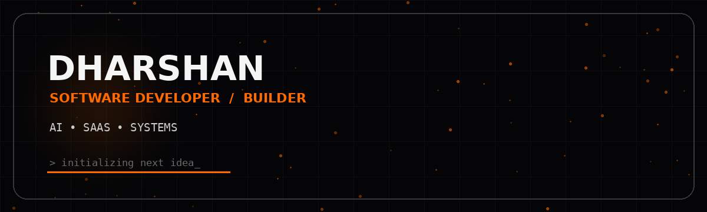
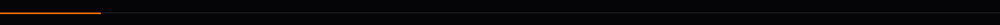
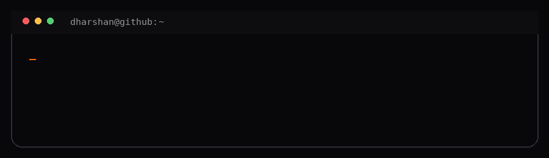

<div align="center">



<br>

<a href="https://github.com/dharshanprabath">

</a>

<br><br>

<a href="https://github.com/dharshanprabath">

</a>
<a href="https://github.com/dharshanprabath?tab=repositories">

</a>

</div>



## `01 / ABOUT`

<table>
<tr>
<td width="58%" valign="top">

### Dharshan

I'm a CSE student and software developer focused on building useful products from scratch.

I like working across **AI, full-stack development, automation, developer tools and mobile applications**.

```text
CURRENT MODE

learn      →  build
experiment →  iterate
ship       →  repeat
```

</td>
<td width="42%" valign="top">



</td>
</tr>
</table>



## `02 / WHAT I BUILD`

<div align="center">

<a href="https://github.com/dharshanprabath">

</a>
<a href="https://github.com/dharshanprabath">

</a>
<a href="https://github.com/dharshanprabath">

</a>
<a href="https://github.com/dharshanprabath">

</a>

</div>

---

## `03 / CURRENT PROJECTS`

<table>
<tr>
<td width="50%" valign="top">

### JARVIS
**AI computer assistant**

An experimental personal AI system for interacting with a computer through tools, vision, voice and automation.

`Python` `FastAPI` `AI` `Computer Vision`

</td>
<td width="50%" valign="top">

### HabitIQ
**Productivity system**

A minimalist habit and productivity application focused on routines, reminders and personal progress.

`React` `Capacitor` `Android` `Supabase`

</td>
</tr>
</table>

<div align="center">

<a href="https://github.com/dharshanprabath?tab=repositories">

</a>

</div>


## `04 / STACK`

<div align="center">

<a href="https://www.python.org/"></a>
<a href="https://isocpp.org/"></a>
<a href="https://developer.mozilla.org/en-US/docs/Web/JavaScript"></a>
<a href="https://www.typescriptlang.org/"></a>
<a href="https://react.dev/"></a>
<a href="https://nextjs.org/"></a>
<a href="https://nodejs.org/"></a>
<a href="https://fastapi.tiangolo.com/"></a>
<a href="https://supabase.com/"></a>
<a href="https://developer.android.com/"></a>
<a href="https://git-scm.com/"></a>
<a href="https://github.com/"></a>

</div>

<p align="center"><sub>click a technology to open its official site</sub></p>


## `05 / GITHUB ANALYTICS`

<div align="center">


</div>

<br>

<div align="center">


</div>

---

## `06 / TOP LANGUAGES`

<div align="center">


</div>


## `07 / CONNECT`

<div align="center">

<a href="https://github.com/dharshanprabath">

</a>

<a href="https://instagram.com/dharshanprabath">

</a>

<!-- Replace this URL with your actual LinkedIn profile -->
<a href="https://www.linkedin.com/">

</a>

</div>

<br>

<div align="center">

```text
BUILD  →  BREAK  →  LEARN  →  REBUILD
```

<br>

<sub>DHARSHAN · SOFTWARE · AI · SYSTEMS</sub>

</div>

<br>

<div align="center">

</div>
